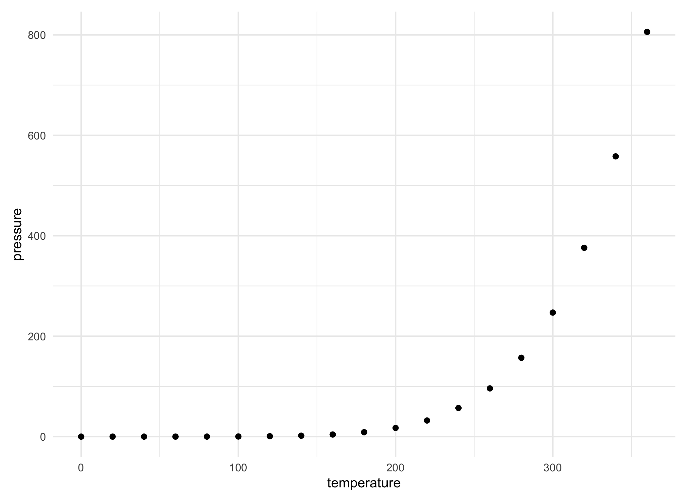
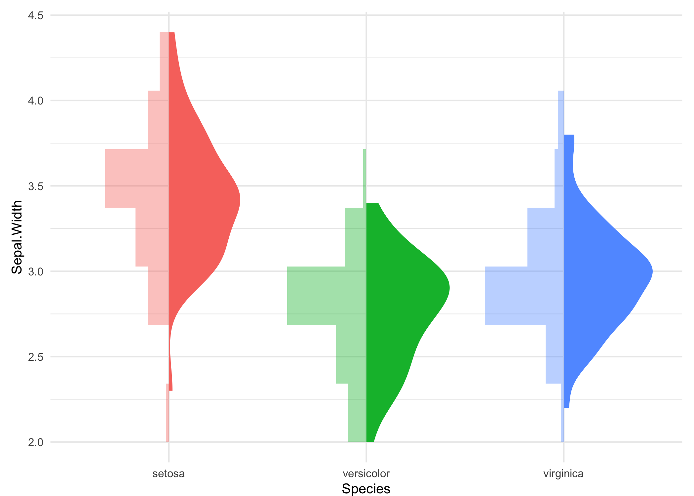
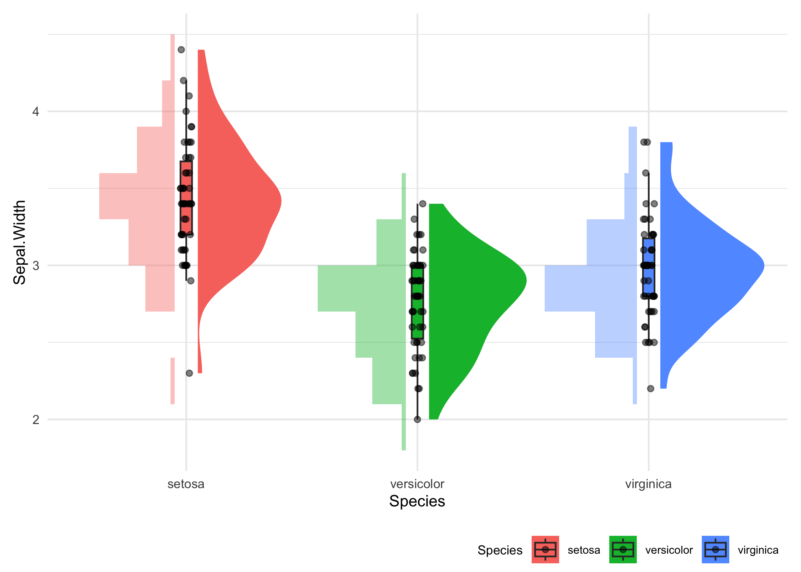
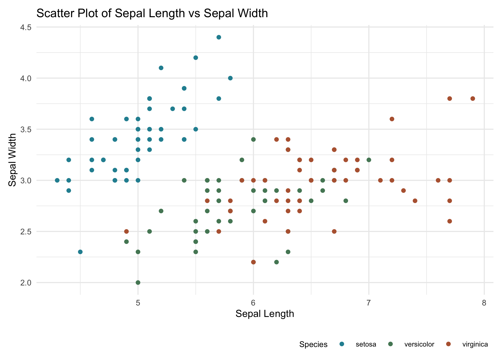
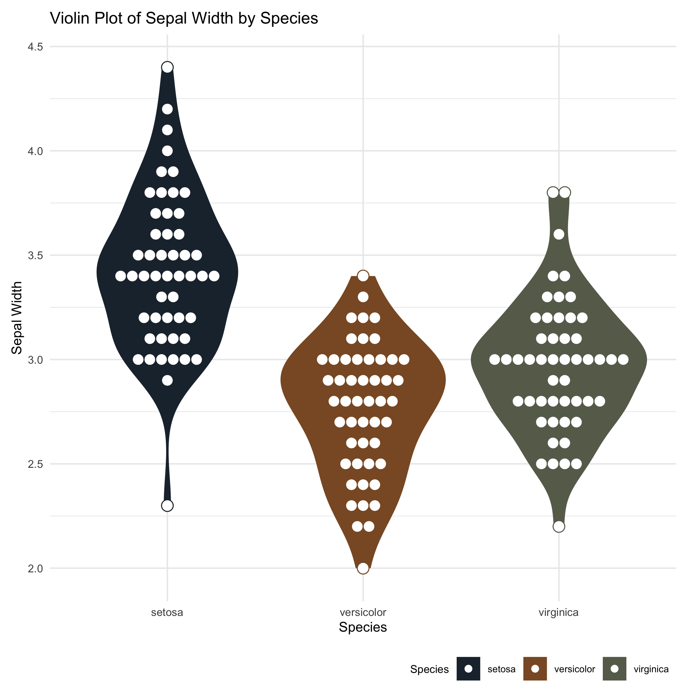

<!-- README.md is generated from README.Rmd. Please edit that file -->

# sdlhRTools

<!-- badges: start -->

[](https://lifecycle.r-lib.org/articles/stages.html#experimental)
[](LICENSE.md)

<!-- badges: end -->

Personal R package with ggplot2 themes, geoms, and color palettes for
data visualization and analysis.

The R package *sdlhRTools* collects helper functions and ggplot2
extensions I use frequently. It started as a personal toolbox, but every
function is documented and examples are included so others can pick up
anything they find useful.

The package is under active development and its API is subject to
change. Feedback, bug reports and suggestions are welcome via [GitHub
issues](https://github.com/sergiodlash/sdlhRTools/issues).

## Overview

| Category | Function | Description |
|----|----|----|
| Theme | `theme_sdlh()` | Compact minimal ggplot2 theme |
| Geom | `geom_violinhist()` | Half violin + histogram to show distributions |
| Palette | `scale_color_paimio()`, `scale_fill_paimio()` | Palette inspired by the Paimio Sanatorium (Alvar Aalto) |
| Palette | `scale_color_glyptotek()`, `scale_fill_glyptotek()` | Palette inspired by the Ny Carlsberg Glyptotek |
| Helper | `paimio_colors()`, `glyptotek_colors()` | Get palette colors as hex codes |

## Installation

The development version is available to install from GitHub:

| Installer | Command | Notes |
|----|----|----|
| pak (recommended) | `pak::pak("sergiodlash/sdlhRTools")` | Fast, resolves dependencies |
| remotes | `remotes::install_github("sergiodlash/sdlhRTools", build_vignettes = TRUE)` | Use this to also build the vignettes |

Once the installation is complete, you can load the package in your R
scripts by using:

``` r
library(ggplot2)
library(sdlhRTools)
```

## Examples

### Themes

#### theme_sdlh()

A compact minimal theme based on `theme_minimal()` with smaller text,
tight margins and bottom right legend.

``` r
library(patchwork)

p <- ggplot(mtcars, aes(wt, mpg, color = factor(cyl))) +
    geom_point(size = 2) +
    labs(
      x = "Weight (1000 lbs)",
      y = "Miles per gallon",
      color = "Cylinders"
    )

(p + ggtitle("ggplot2 default") + theme_grey()) |
(p + ggtitle("Custom Theme") + theme_sdlh())
```



### Geoms

#### geom_violinhist()

The `geom_violinhist()` plots a half violin and a histogram together.
This shows both the smoothed density and the binned counts of each group
in a single layer.

``` r
ggplot(iris, aes(Species, Sepal.Width, fill = Species)) +
  geom_violinhist(show.legend = FALSE) +
  theme_sdlh()
```



Because it is a regular ggplot2 layer, it can be combined with other
geoms. For example, adding a small `nudge_value` leaves a gap in the
middle for a boxplot and the raw data points:

``` r
ggplot(iris, aes(x = Species, y = Sepal.Width, fill = Species)) +
  geom_violinhist(
    binwidth = 0.3,
    nudge_value = 0.05
  ) +
  geom_boxplot(
    width = 0.05,
    outlier.shape = NA
  ) +
  geom_jitter(
    height = 0,
    width = 0.025,
    alpha = 0.5
  ) +
  theme_sdlh()
```



See `vignette("geom_violinhist", package = "sdlhRTools")`
([source](vignettes/geom_violinhist.Rmd)) for more example and styling
options.

### Color palettes

#### Paimio Sanatorium

Color palette inspired in the Paimio Sanatorium by architect Alvar Aalto
in Finland.

``` r
ggplot(iris, aes(x = Sepal.Length, y = Sepal.Width, color = Species)) +
  geom_point() +
  labs(
    title = "Scatter Plot of Sepal Length vs Sepal Width",
    x = "Sepal Length",
    y = "Sepal Width"
  ) +
  scale_color_paimio(palette = "contrast", reverse = TRUE) +
  theme_sdlh()
```



#### Ny Carlsberg Glyptotek

Color palette inspired in the Ny Carlsberg Glyptotek in Copenhagen.

``` r
ggplot(iris, aes(x = Species, y = Sepal.Width, fill = Species, color = Species)) +
  geom_violin(linewidth = 0) +
  geom_dotplot(binaxis = "y", stackdir = "center", fill = "white", dotsize = 0.8, binwidth = 0.07) +
  labs(
    title = "Violin Plot of Sepal Width by Species",
    x = "Species",
    y = "Sepal Width"
  ) +
  scale_fill_glyptotek() +
  scale_color_glyptotek() +
  theme_sdlh()
```


